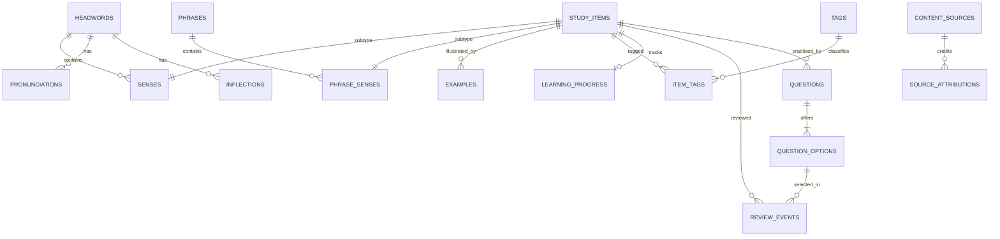

# English Learning App — Design & Implementation Plan for an AI Coding Agent

**Version:** 1.0  
**Date:** 15 October 2026  
**Target:** Flutter mobile app (Android/iOS), fully offline, local SQLite database, no backend/server

## 1. Purpose and product scope

Build an English-learning app that lets one user manage vocabulary and expressions, study them by CEFR level, practise multiple-choice quizzes, review items adaptively, and schedule local reminders. All learning data and preferences live on the device.

### Core requirements

1. Vocabulary entries with spelling, pronunciation (IPA and optional local audio), inflections, notes and optional overall CEFR label.
2. Each **sense/meaning owns its own part of speech (POS)**, English definition, Vietnamese meaning, CEFR level, grammar/usage notes, register/domain labels and examples. Never assign one POS to the whole headword.
3. Phrases, idioms, collocations, phrasal verbs, expressions and slang are first-class learning items with their own meanings, CEFR level, examples and tags.
4. Search, filter and CRUD menus for words, meanings/senses, phrases, tags and quiz content where user-created content is supported.
5. Multiple-choice quizzes with answer choices, correct answer, explanation, result history and per-item learning progress.
6. Adaptive review based on due date, correct/incorrect history, difficulty and user-selected CEFR/topic preferences.
7. Configurable local notifications by time, weekdays and content type (word, phrase, review, quiz). A notification can open the appropriate screen or quiz.
8. JSON backup/export and restore/import. No account, cloud sync, API server or runtime network dependency.

### Out of scope for the first release

- User accounts, sign-in, cloud backend, multi-device sync or server APIs.
- Calling online dictionaries while the app is running.
- Generative AI or any cloud-based recommendation service at runtime.
- Downloading copyrighted dictionary text/audio without explicit permission or a suitable licence.
- Complex analytics, social features or leaderboards.

## 2. Technical decisions

| Area | Decision | Reason / rule |
|---|---|---|
| App | Flutter / Dart | Existing mobile-app target. |
| Local database | SQLite through **Drift** | Typed queries, transactions, reactive streams and schema migrations are useful for a relational dictionary model. |
| UI state | Keep the project's current state-management approach. If the project already uses Provider, continue with Provider/ChangeNotifier rather than adding a second state system. | Avoid unnecessary rewrites. |
| Navigation | Keep `go_router` if already in the project. Use a shell/scaffold for top-level destinations and detail/edit routes. | Preserve existing route conventions. |
| Preferences | SQLite for structured app/notification preferences; `shared_preferences` only for tiny non-relational preferences if needed. | Do not store learning progress in key-value storage. |
| Notifications | `flutter_local_notifications` or another maintained plugin selected after checking current compatibility. | All reminders are scheduled locally. Do not promise exact delivery: the OS may defer notifications. |
| Search | Indexed SQLite `LIKE` initially; consider Drift/SQLite FTS5 for full-text search if the bundled SQLite configuration supports it. | Avoid making FTS5 a release blocker. |
| Audio | Local asset path or bundled asset key; audio is optional. | No remote audio URLs in offline mode. |
| Backup | Versioned JSON export/import for user content and progress; validate before committing import. | More portable and safer than blindly overwriting the live database. |
| ID | Stable UUID/string IDs for content and history. | Safer for export/import and references than relying on row-number IDs. |

Use the project's existing dependency versions as the starting point. Check current official package documentation before adding or upgrading dependencies; do not blindly upgrade the whole project.

## 3. Data design

### 3.1 Design rules

- A `headword` represents a dictionary entry such as `run` or `book`; it has spelling and word-level metadata, not a single POS.
- A `sense` represents one meaning of a headword. Its `part_of_speech` is required and belongs to that sense. One headword can have noun, verb and other senses.
- Store both `definition_en` and `meaning_vi` separately. One is a short English learner definition; the other is the Vietnamese meaning/translation.
- CEFR level at the **sense** level is canonical. A headword-level CEFR label is optional convenience metadata only; it must not overwrite or imply that all senses share the same level.
- An idiom or phrase may have multiple senses as well; POS or grammatical function belongs to its individual phrase sense if relevant.
- `study_items` is a shared parent for word senses and phrase senses so progress, review events and tags can treat them uniformly.
- Use foreign keys, `ON DELETE` rules, unique constraints, checks and indexes. Enable SQLite foreign-key enforcement.
- Store timestamps as UTC epoch milliseconds. Store notification wall-clock time as `HH:mm` with weekday settings; recalculate schedules when the local timezone changes or the app next opens.
- Empty/missing data must remain nullable where valid. Never use a fake CEFR value such as `A0` to represent unknown; use `NULL`.

### 3.2 Entity relationship diagram



### 3.3 Tables and principal fields

The names below are proposed logical names. Match them to Drift's Dart naming conventions, e.g. `Headwords`, `Senses`, `StudyItems`.

#### `headwords`
- `id TEXT PRIMARY KEY` — UUID.
- `spelling TEXT NOT NULL` — displayed headword.
- `normalized_spelling TEXT NOT NULL` — lower-case/trimmed value for lookup.
- `homograph_no INTEGER NOT NULL DEFAULT 1` — distinguish entries with the same spelling when their pronunciation/entry identity differs.
- `cefr_level TEXT NULL` — optional overall label; allowed values `A1`, `A2`, `B1`, `B2`, `C1`, `C2`.
- `notes TEXT NULL`, `is_archived INTEGER NOT NULL DEFAULT 0`.
- `created_at_ms INTEGER NOT NULL`, `updated_at_ms INTEGER NOT NULL`.
- Unique constraint: `(normalized_spelling, homograph_no)`.

#### `pronunciations`
- `id TEXT PRIMARY KEY`.
- `headword_id TEXT NULL REFERENCES headwords(id) ON DELETE CASCADE`.
- `sense_id TEXT NULL REFERENCES study_items(id) ON DELETE CASCADE`.
- `accent TEXT NOT NULL` — controlled values such as `uk`, `us`, `au`, `other`.
- `ipa TEXT NULL`.
- `audio_asset_key TEXT NULL` — key/path to a local asset, not a URL.
- `source_note TEXT NULL`, `licence_note TEXT NULL`.
- CHECK constraint: exactly one of `headword_id` or `sense_id` is non-null. Use `sense_id` for pronunciations that differ by sense.

#### `inflections`
- `id TEXT PRIMARY KEY`, `headword_id TEXT NOT NULL REFERENCES headwords(id) ON DELETE CASCADE`.
- `form TEXT NOT NULL`, `form_type TEXT NOT NULL` — e.g. plural, past, past participle, third-person singular, -ing, comparative, superlative, alternative spelling.
- Unique constraint: `(headword_id, form, form_type)`.

#### `study_items`
- `id TEXT PRIMARY KEY` — stable UUID shared by the subtype row and progress records.
- `item_type TEXT NOT NULL CHECK (item_type IN ('sense','phrase_sense'))`.
- `created_at_ms INTEGER NOT NULL`.

#### `senses`
- `id TEXT PRIMARY KEY REFERENCES study_items(id) ON DELETE CASCADE`.
- `headword_id TEXT NOT NULL REFERENCES headwords(id) ON DELETE CASCADE`.
- `sense_number INTEGER NOT NULL` — ordering in the entry.
- `part_of_speech TEXT NOT NULL` — e.g. noun, verb, adjective, adverb, preposition, pronoun, determiner, conjunction, interjection, auxiliary, modal, other.
- `definition_en TEXT NOT NULL`, `meaning_vi TEXT NULL`.
- `cefr_level TEXT NULL` — canonical CEFR classification for this sense.
- `register_label TEXT NULL` — e.g. formal, informal, slang, offensive, archaic.
- `domain_label TEXT NULL` — e.g. business, travel, academic.
- `grammar_note TEXT NULL`, `usage_note TEXT NULL`, `is_active INTEGER NOT NULL DEFAULT 1`.
- Unique constraint: `(headword_id, sense_number)`.

#### `phrases`
- `id TEXT PRIMARY KEY`, `phrase TEXT NOT NULL`, `normalized_phrase TEXT NOT NULL`.
- `phrase_type TEXT NOT NULL CHECK (phrase_type IN ('idiom','collocation','phrasal_verb','slang','expression','other') )`.
- `cefr_level TEXT NULL` — optional overall phrase label.
- `notes TEXT NULL`, `is_archived INTEGER NOT NULL DEFAULT 0`.
- `created_at_ms INTEGER NOT NULL`, `updated_at_ms INTEGER NOT NULL`.
- Index `normalized_phrase`; do not force a single global unique constraint if homonymous phrases or variant forms must coexist. The UI should warn about duplicates.

#### `phrase_senses`
- `id TEXT PRIMARY KEY REFERENCES study_items(id) ON DELETE CASCADE`.
- `phrase_id TEXT NOT NULL REFERENCES phrases(id) ON DELETE CASCADE`.
- `sense_number INTEGER NOT NULL DEFAULT 1`.
- `part_of_speech TEXT NULL` — nullable only when POS is not applicable; if the phrase functions as a grammatical unit, populate it.
- `definition_en TEXT NOT NULL`, `meaning_vi TEXT NULL`, `cefr_level TEXT NULL`.
- `register_label TEXT NULL`, `domain_label TEXT NULL`, `grammar_note TEXT NULL`, `usage_note TEXT NULL`, `is_active INTEGER NOT NULL DEFAULT 1`.
- Unique constraint: `(phrase_id, sense_number)`.

#### `examples`
- `id TEXT PRIMARY KEY`, `study_item_id TEXT NOT NULL REFERENCES study_items(id) ON DELETE CASCADE`.
- `english_text TEXT NOT NULL`, `vietnamese_text TEXT NULL`, `note TEXT NULL`.
- `audio_asset_key TEXT NULL`, `sort_order INTEGER NOT NULL DEFAULT 0`.
- `source_id TEXT NULL REFERENCES content_sources(id) ON DELETE SET NULL`.

#### `tags` and `item_tags`
- `tags`: `id`, `slug TEXT UNIQUE NOT NULL`, `name TEXT NOT NULL`, `category TEXT NOT NULL`, `description TEXT NULL`.
- `item_tags`: `study_item_id TEXT NOT NULL REFERENCES study_items(id) ON DELETE CASCADE`, `tag_id TEXT NOT NULL REFERENCES tags(id) ON DELETE CASCADE`, composite primary key `(study_item_id, tag_id)`.
- Suggested categories: topic, register, exam, grammar, custom. Do not encode POS only as a tag; POS belongs in `senses.part_of_speech`.

#### `questions`
- `id TEXT PRIMARY KEY`.
- `target_item_id TEXT NULL REFERENCES study_items(id) ON DELETE SET NULL`.
- `question_type TEXT NOT NULL` — v1 supports `meaning_choice`, `definition_choice`, `cloze_choice`.
- `prompt TEXT NOT NULL`, `explanation TEXT NULL`, `cefr_level TEXT NULL`.
- `content_origin TEXT NOT NULL CHECK (content_origin IN ('seed','user','app_generated'))`.
- `is_active INTEGER NOT NULL DEFAULT 1`, `created_at_ms INTEGER NOT NULL`.

#### `question_options`
- `id TEXT PRIMARY KEY`, `question_id TEXT NOT NULL REFERENCES questions(id) ON DELETE CASCADE`.
- `option_text TEXT NOT NULL`, `sort_order INTEGER NOT NULL`, `is_correct INTEGER NOT NULL CHECK (is_correct IN (0,1))`.
- At least two options and exactly one correct option per active question. Validate in app-level repository/use case and add a partial unique index for at most one correct option where supported.

#### `learning_progress`
- `study_item_id TEXT PRIMARY KEY REFERENCES study_items(id) ON DELETE CASCADE`.
- `status TEXT NOT NULL CHECK (status IN ('new','learning','review','mastered'))`.
- `repetition_count INTEGER NOT NULL DEFAULT 0`, `interval_days REAL NOT NULL DEFAULT 0`.
- `ease_factor REAL NOT NULL DEFAULT 2.5`, `lapses INTEGER NOT NULL DEFAULT 0`.
- `due_at_ms INTEGER NULL`, `last_reviewed_at_ms INTEGER NULL`.
- `total_correct INTEGER NOT NULL DEFAULT 0`, `total_incorrect INTEGER NOT NULL DEFAULT 0`.
- `is_favorite INTEGER NOT NULL DEFAULT 0`, `updated_at_ms INTEGER NOT NULL`.
- Create a row lazily on first study, or initialise it as `new` when a seed item is installed. Keep that choice consistent.

#### `review_events`
- `id TEXT PRIMARY KEY`, `study_item_id TEXT NOT NULL REFERENCES study_items(id) ON DELETE CASCADE`.
- `question_id TEXT NULL REFERENCES questions(id) ON DELETE SET NULL`.
- `selected_option_id TEXT NULL REFERENCES question_options(id) ON DELETE SET NULL`.
- `is_correct INTEGER NULL CHECK (is_correct IN (0,1))`, `quality INTEGER NULL CHECK (quality BETWEEN 0 AND 5)`.
- `elapsed_ms INTEGER NULL`, `study_mode TEXT NOT NULL` — review, quiz, notification, self-rating.
- `answered_at_ms INTEGER NOT NULL`.

#### `user_settings`
- `key TEXT PRIMARY KEY`, `value_json TEXT NOT NULL`, `updated_at_ms INTEGER NOT NULL`.
- Use a small typed settings repository so UI code does not manipulate raw JSON keys throughout the app.

#### `notification_rules`
- `id TEXT PRIMARY KEY`, `rule_type TEXT NOT NULL` — word, phrase, due_review, quiz.
- `enabled INTEGER NOT NULL DEFAULT 0`, `time_of_day TEXT NOT NULL` in `HH:mm` format.
- `weekdays_mask INTEGER NOT NULL DEFAULT 127` (document which bit maps to each weekday).
- `daily_count INTEGER NOT NULL DEFAULT 1`, `min_cefr TEXT NULL`, `max_cefr TEXT NULL`, `tag_filter_id TEXT NULL REFERENCES tags(id) ON DELETE SET NULL`.
- `updated_at_ms INTEGER NOT NULL`.

#### `content_sources` and `source_attributions`
- Keep the source/credit, licence/permission and attribution metadata for content used in the bundled dataset.
- Do not copy dictionary definitions, examples, phonetics or audio from Oxford, Cambridge, Merriam-Webster or other proprietary sources unless the project's licence explicitly permits that use. Prefer independently authored learner definitions/examples or datasets with suitable licences, and record provenance.

### 3.4 Indexes and integrity requirements

At minimum, add indexes for:
- `headwords.normalized_spelling`;
- `senses.headword_id`, `senses.cefr_level`, `senses.part_of_speech`;
- `phrases.normalized_phrase`, `phrase_senses.phrase_id`, `phrase_senses.cefr_level`;
- `examples.study_item_id`;
- `item_tags.tag_id` and `item_tags.study_item_id`;
- `questions.target_item_id`, `question_options.question_id`;
- `learning_progress.due_at_ms`, `review_events.study_item_id`, `review_events.answered_at_ms`.

Use transactions when saving a headword together with multiple senses/examples/tags, deleting or replacing an item, importing data, or recording an answer plus progress update. A failed transaction must roll back completely. Define cascade/delete policy explicitly and add migration tests before shipping schema changes.

## 4. Application architecture

Use a feature-first structure with separation between UI, application logic and data access. Keep the design pragmatic; do not create excessive abstraction for every field.

```text
lib/
  app/
    app.dart
    router.dart
    theme/
  core/
    database/
      app_database.dart
      tables/
      daos/
      migrations/
    notifications/
      notification_service.dart
      notification_scheduler.dart
    backup/
      backup_service.dart
      backup_models.dart
    errors/
    utils/
  features/
    home/
    vocabulary/
      data/
      domain/
      presentation/
    phrases/
      data/
      domain/
      presentation/
    tags/
    quiz/
    review/
    progress/
    settings/
  shared/
    widgets/
    models/
```

### Layer responsibilities

- **Presentation:** screens, widgets, form validation feedback and view state. No direct SQL.
- **Domain/application:** use cases such as `SaveHeadword`, `DeleteSense`, `SearchStudyItems`, `StartQuiz`, `SubmitAnswer`, `GetDueItems`, `UpdateNotificationRules`, `ExportBackup`, `ImportBackup`.
- **Data:** Drift DAOs/repositories, row mapping, seed import, migration and transaction handling.
- **Core services:** local notifications, date/time utilities, backup file handling and shared errors.

Use a repository interface when it improves testing or separates use cases from Drift. Avoid duplicating the same business rule in both widget and DAO. Keep the notification service behind a small interface so tests can use a fake scheduler.

## 5. Navigation and screens

### Primary destinations

1. **Home** — daily goal, due review count, quick search, continue studying and recent progress.
2. **Vocabulary** — headword list, search, filters for CEFR, POS, tags and favourites; create/edit/delete entries.
3. **Phrases** — idioms, collocations, phrasal verbs, slang and expressions; same search/filter/CRUD patterns.
4. **Review** — due items selected by the review scheduler.
5. **Quiz** — configure a session, answer multiple-choice questions and view results.
6. **Settings** — CEFR preferences, study goals, notifications, language/theme if already supported, export/import and data reset.

### Detail and form screens

- **Headword detail:** spelling, UK/US IPA/audio where present, inflections, notes, senses grouped by sense number; each sense visibly shows its own POS, definition, Vietnamese meaning, CEFR, labels, examples and tags.
- **Sense editor:** POS is selected on each sense card/form, not on the parent headword form. Support adding multiple senses to the same headword.
- **Phrase detail/editor:** phrase type, one or more phrase senses, definitions, translation, CEFR, register/domain, examples and tags.
- **Tag manager:** create, rename and delete tags, with a warning/confirmation before deleting a used tag.
- **Quiz result:** score, corrections/explanations, review-again action, and progress update.
- **Backup screen:** export, import/restore, validation preview and explicit confirmation before replacing/merging existing data.

Use empty states and validation messages. Destructive actions require confirmation. A delete operation must not leave orphaned examples, tags or progress records.

## 6. Key use cases and business rules

### 6.1 Save/edit a headword

1. Validate spelling and normalise it for duplicate lookup.
2. Save the headword and all child senses/examples/tags in one transaction.
3. Each sense requires `part_of_speech` and `definition_en`; Vietnamese meaning, CEFR, labels and examples may be optional depending on content policy.
4. Assign stable IDs when records are created; do not regenerate IDs when editing.
5. If the headword is removed, use a clear warning and cascade policy. Prefer archive for bundled/reference content where deleting would make seed upgrades hard to reconcile; hard-delete user-created entries only when safe.

### 6.2 Search and filter

- Search headword, phrase, English definition and Vietnamese meaning.
- Normalise case and whitespace consistently. Preserve the original display value.
- Combine CEFR, POS, tag, favourites and item type filters without losing the current query.
- Use indexed prefix/substring search for v1. Add FTS5 only after verifying that the shipped SQLite runtime supports it and that the index is rebuilt correctly after import.

### 6.3 Quiz generation

- Start with 4 options when enough distractors exist; allow 2–3 if the dataset cannot supply 4 valid distinct options.
- Exactly one option is correct. Never use duplicate option strings in the same question.
- Distractors should be from a comparable CEFR level or grammatical category where possible, and must not be another valid answer for the prompt.
- Exclude inactive/deleted items and optionally exclude recently repeated questions.
- Store the answer event and update `learning_progress` in one transaction.
- Show explanation and the relevant sense after answering. Do not reveal the correct answer before an answer is submitted.

### 6.4 Adaptive review (v1)

Use a transparent local algorithm; do not call this “AI” or imply it is a trained model.

1. Prioritise items whose `due_at_ms` is past or null.
2. Rank overdue items by overdue duration, recent error rate, lapse count and user's selected CEFR/tag preferences.
3. Reserve a configurable percentage of a session for new items so the user keeps learning new content; the remainder reviews due items.
4. Apply a simplified SM-2 schedule to each `study_item_id`:
   - On failure/quality below 3: reset repetition count, set interval to 1 day, increase lapse count.
   - On the first successful review: interval 1 day.
   - On the second successful review: interval 6 days.
   - On later successful reviews: `interval = round(previous_interval * ease_factor)` with a minimum of 1 day.
   - Update ease factor using the SM-2 quality formula; clamp to at least 1.3.
5. Multiple-choice correct/incorrect can map to a default quality (for example 4/1); allow optional self-rating if desired. Document that quiz correctness is an imperfect proxy for recall.
6. Keep all algorithm values deterministic and covered by unit tests. Allow constants to be tuned without a schema rewrite.

Example priority score (tune by tests/usability rather than treating as a scientific measurement):

```text
priority = overdue_factor
         + 2.0 * recent_error_rate
         + 0.5 * lapse_count_capped
         + user_preference_boost
```

Avoid permanently starving new items or lower-priority topics. Add a small random tie-breaker only among similarly scored candidates and make tests deterministic by injecting a random source.

### 6.5 Local notifications

- Request notification permission only after the user turns reminders on or taps an enable action, and explain the value before requesting permission.
- Save rules locally, then schedule/cancel matching notifications. Reschedule when rules or the system timezone changes and whenever the app starts/resumes.
- Do not depend on Dart code waking up at the exact notification time to query SQLite. For notifications with specific content, select an item while the app is active and schedule a notification with a payload containing the item ID/type; tapping it opens the corresponding detail/review/quiz route.
- If scheduling generic reminders, use a generic message and choose content when the app opens.
- Handle notification permission denied, app reboot (Android configuration if required), DST/timezone changes, duplicate schedules and cancellation.
- Treat exact delivery time as best-effort because OS power and permission policies can defer or block delivery. Avoid exact-alarm permissions unless the product genuinely requires them and platform requirements are satisfied.

### 6.6 Export/import

- Define a versioned JSON format with `schemaVersion`, `exportedAt`, content, tags, settings (optional), progress and review history.
- Import must parse and validate fully before modifying live data. Show a preview (counts, warnings, collisions).
- Support an explicit mode: `merge` or `replace`. Never silently erase existing user data.
- Use a transaction for the database write. Preserve IDs where possible; resolve collisions by a documented rule.
- Add a migration path between backup JSON versions. Keep a small valid fixture for automated import/export tests.
- Keep content/licence metadata in exports. Do not export transient runtime state that is not useful to restore.

## 7. Seed-data strategy and content quality

The app is offline, so any initial dictionary data must ship inside the app or be imported by the user. Treat content creation/licensing as a separate workstream from database implementation.

- Begin with a small, hand-checked seed dataset that demonstrates all supported structures: same headword with multiple senses/POS, an ambiguous CEFR level, multiple examples, pronunciation variants, a phrase with multiple senses, tags and quiz options.
- Define a seed JSON schema and validate it before import. Keep the data version and checksum so app upgrades do not duplicate content.
- Use CEFR values only when there is a suitable source or a documented editorial decision. Unknown values stay null.
- Store provenance/licence notes. Do not scrape or redistribute proprietary dictionary entries/audio without permission. “Using a dictionary as a structural reference” does not grant permission to copy its content.
- Do not bundle thousands of low-quality auto-generated examples just to increase word count. Prefer a smaller verified dataset and an import pipeline that can be expanded.

## 8. Implementation phases and deliverables

Implement sequentially. At the end of each phase, run the listed checks and report changed files, test output and known gaps. Do not build every screen before validating the data model.

### Phase 0 — Repository inspection and baseline

**Tasks**
- Inspect the existing Flutter version, dependencies, app entry point, routing, state management, theme/localisation, folder layout and tests.
- Identify existing conventions; reuse them unless there is a clear incompatibility.
- Record baseline results of `flutter analyze` and `flutter test`.
- Propose a concise file-level implementation plan before broad edits.

**Deliverable / acceptance**
- A short repo assessment and agreed file map.
- No unrelated refactor; baseline issues are recorded separately from new regressions.

### Phase 1 — Database foundation

**Tasks**
- Add Drift and code generation dependencies only as needed.
- Implement tables, foreign keys, constraints, indexes and database open/setup code.
- Enable foreign keys; configure transactions and migration strategy.
- Implement schema version 1 plus migration-test infrastructure.
- Add a small representative seed dataset and idempotent seed versioning.

**Acceptance**
- Fresh database creates successfully.
- Seeding twice does not duplicate content.
- One headword can have noun and verb senses with distinct CEFR levels and examples.
- Invalid foreign keys and invalid CEFR values are rejected or safely validated.
- Migration tests preserve existing user data.

### Phase 2 — Repositories and core use cases

**Tasks**
- Implement DAOs/repositories for headwords, senses, phrases, phrase senses, examples, tags, questions, progress and settings.
- Implement create/read/update/archive/delete and multi-filter search.
- Use transactions for aggregate updates.
- Add unit tests for duplicates, delete rules, filtering, search normalisation and rollback behaviour.

**Acceptance**
- No screen runs raw SQL.
- CRUD operations work for both vocabulary and phrases.
- Sense POS and CEFR stay at sense level.
- Repository errors are surfaced as actionable UI errors, not silent failures.

### Phase 3 — Vocabulary, phrase and tag UI

**Tasks**
- Build primary navigation, list/search/filter screens, detail screens and forms.
- Add multiple-sense editor, example management, CEFR/POS/register/domain fields and tag management.
- Add favourites and archive/delete confirmation.
- Support empty, loading, validation and error states.

**Acceptance**
- A user can create a headword with multiple senses, edit one sense without changing the others, add examples/tags, search it and delete/archive it safely.
- Phrase entries follow the same quality bar.
- All forms remain usable on normal phone screen sizes and with the keyboard open.

### Phase 4 — Quiz, history and adaptive review

**Tasks**
- Implement question creation/seed loading, option validation, session generation and result screen.
- Implement review-event recording and progress updates in one transaction.
- Implement scheduler and unit tests for due dates, lapse/reset behaviour, ease-factor minimum, mixed new/review sessions and deterministic tie-breaking.
- Add progress summary to Home.

**Acceptance**
- Exactly one correct option is shown for each active question.
- Answering records history and updates progress once only.
- Restarting the app retains progress.
- Due review selects the intended items and never includes archived items.

### Phase 5 — Notification settings and scheduling

**Tasks**
- Build settings for enable/disable, wall-clock time, weekdays, content type and optional CEFR/tag filter.
- Implement permission handling, unique notification IDs, payload routing, cancellation and rescheduling.
- Add tests using a fake notification scheduler; document manual Android/iOS checks.

**Acceptance**
- Changing a reminder updates the schedule without duplicates.
- Disabling a rule cancels its scheduled notifications.
- Tapping a supported notification opens the right route/item or the quiz entry point.
- Denied permissions do not crash the app and the user can still study manually.

### Phase 6 — Backup, import and hardening

**Tasks**
- Implement versioned JSON export/import, preview, merge/replace mode, validation and rollback on failure.
- Add data integrity checks, backup fixtures and large-dataset performance smoke tests.
- Add app lifecycle/timezone notification rescheduling.
- Add accessibility checks and improve errors/empty states.

**Acceptance**
- Export then import into a clean database produces equivalent user data.
- Invalid backup leaves the current database untouched.
- Merge does not duplicate same-ID records; replace requires explicit confirmation.
- Search/list use suitable indexes and remain responsive with at least 20,000 representative headwords in a test dataset.

### Phase 7 — Release readiness

**Tasks**
- Run unit, widget and integration tests; run `dart format`, `flutter analyze` and `flutter test`.
- Test Android and iOS notification permission and tap-through flows on real devices or reliable platform simulators.
- Check clean install, app upgrade/migration, restore, offline mode and app restart.
- Document manual QA, known limitations and data/licence sources.

**Acceptance**
- No new analyzer errors, failing tests or known data-loss issue.
- Core vocabulary, quiz, review, notification configuration and backup flows work without a network connection.
- No backend URL, runtime API dependency, secret or analytics SDK is introduced without explicit approval.

## 9. Test matrix

| Area | Required tests |
|---|---|
| Schema | Fresh creation, foreign keys, unique constraints, indexes, migration and rollback. |
| Sense model | One spelling with multiple senses and POS; independent CEFR and examples for each sense. |
| CRUD | Create/edit/delete/archive; child records; duplicate warnings; transaction rollback. |
| Search | Case/whitespace normalisation, English/Vietnamese fields, combined filters, no-result state. |
| Quiz | One correct answer, no duplicate options, answer explanation, event/progress consistency. |
| Scheduler | New item, correct answer intervals, failure/lapse reset, timezone boundary, due order. |
| Notifications | Permission granted/denied, schedule edit, cancel, reboot/timezone behaviour, notification tap routing. |
| Backup | Export/import round-trip, old schema version, malformed JSON, ID collision, merge/replace, atomic rollback. |
| Offline | Launch and all core study flows work with airplane mode enabled. |
| Performance | Seed/import and searching 20k+ headwords, scrolling lists without loading the whole database into memory. |

## 10. Definition of Done

A feature is done only when:

1. Implementation is connected to persistent local data, not mock-only UI.
2. Validation and failure states are handled.
3. Relevant unit/widget/integration tests are added.
4. `dart format`, `flutter analyze` and relevant tests run successfully, or any pre-existing failure is explicitly documented.
5. No secret, network backend, external dictionary scraping or unrelated architecture migration is added.
6. The AI agent reports: summary, changed files, commands/tests run, results, known limitations and next phase.

## 11. Instructions to the AI coding agent

Copy this section as the execution prompt after attaching this document to the coding task.

> You are implementing the English-learning Flutter app described in this specification. Treat this document as the product and architecture source of truth.
>
> **First inspect the existing repository.** Do not assume its folder structure, package versions or state-management approach. Preserve existing working conventions, especially routing and state management, unless a documented blocker requires a change. Report the initial project state and baseline test/analyzer results before making broad edits.
>
> Implement one phase at a time in the order in Section 8. For each phase: (1) state a short plan, (2) make the code changes, (3) run formatting, analysis and relevant tests, (4) fix regressions, and (5) report changed files, verification results and remaining risks. Do not claim tests passed unless you ran them and saw the result. Do not stop at architectural diagrams or placeholder screens; implement working persistence and behaviour.
>
> Non-negotiable rules:
> - The app runs offline and has no server/backend/login/cloud sync.
> - Use SQLite through Drift unless repository constraints demonstrate a concrete reason not to.
> - POS belongs to each `sense`, never to the whole headword.
> - Word senses and phrase senses share a stable `study_items` identity for tags, progress, review events and quizzes.
> - Use transactions for compound writes and answer/progress updates. Write migration tests before changing the schema.
> - Do not hardcode content in widgets; load it through repositories/use cases.
> - Do not copy proprietary dictionary definitions, examples or audio without a compatible licence. Preserve source and attribution metadata for bundled content.
> - Never silently overwrite user data during import or delete a collection of child records without a clear policy.
> - Use local notification payloads and OS-compatible scheduling; do not rely on running arbitrary Dart code at the exact alarm time.
> - Do not upgrade unrelated dependencies or refactor unrelated modules. Keep changes small and reviewable.
> - Prefer typed models, clear naming, null safety and explicit errors. Avoid broad `dynamic`, ignored exceptions, fake success values and unimplemented TODOs in delivered flows.
>
> If the existing repository conflicts with the specification, explain the conflict and propose the smallest safe adjustment. Do not invent requirements. Make reasonable defaults for non-critical details and record them. Prioritise data integrity and a complete vertical slice over building many unfinished screens.

## 12. References for implementation

- Flutter guidance on choosing local persistence and SQLite/Drift: https://docs.flutter.dev/data-and-backend/persistence/choose-a-database
- Drift documentation: https://pub.dev/packages/drift and https://drift.simonbinder.eu/
- Drift FTS5 documentation: https://pub.dev/documentation/drift/latest/extensions_fts5/
- `go_router` package documentation (only if used in the existing app): https://pub.dev/packages/go_router
- `flutter_local_notifications` package documentation: https://pub.dev/packages/flutter_local_notifications

Package APIs and platform requirements can change. Verify the installed/current package docs during implementation rather than assuming an API copied from an older example is still valid.
