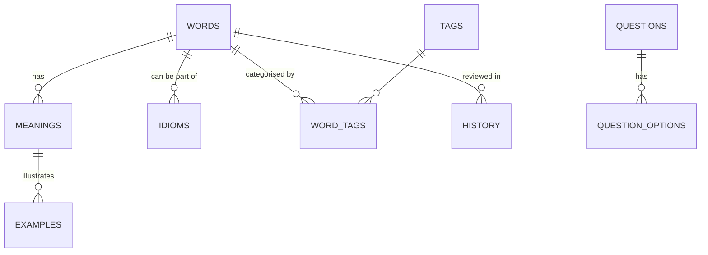
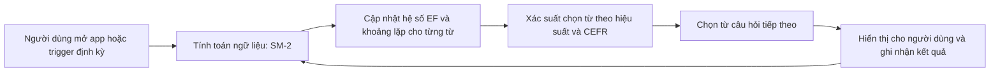

# Tóm tắt  
Báo cáo này đề xuất một thiết kế toàn diện cho ứng dụng học tiếng Anh offline (Flutter + SQLite/Drift) với dữ liệu từ điển (theo chuẩn CEFR). Hệ thống bao gồm các bảng **Từ vựng**, **Nghĩa của từ**, **Ví dụ**, **Cụm từ/Thành ngữ**, **Tag phân loại**, **Câu hỏi trắc nghiệm**, **Lịch sử người dùng**, **Cài đặt thông báo**… Mỗi từ vựng sẽ có các ngữ nghĩa (sense) kèm loại từ, cách phát âm, ví dụ minh họa, và có thể gắn nhiều tag chuyên đề. Thông tin CEFR (A1–C2) được lưu trong từ hoặc nghĩa phù hợp. Quan hệ bảng được biểu diễn qua sơ đồ ER (dưới phần 3). Các kiểu dữ liệu chủ yếu là **INTEGER** (khóa chính, liên kết), **TEXT** (từ, định nghĩa, ví dụ, tag), **REAL/DECIMAL** (thang điểm đánh giá), **BOOLEAN** hoặc **INTEGER** (cờ). Để tăng hiệu năng, các cột ngoại khóa và cột hay truy vấn (như `word.text`) được đánh chỉ mục (theo khuyến cáo của SQLite: “cần tạo chỉ mục trên cột khóa ngoại”).  

Tài liệu tham khảo cấu trúc từ điển cho thấy mỗi mục từ bao gồm *từ* (headword), *phát âm*, *từ loại*, và các *ngữ nghĩa* kèm *định nghĩa*, *ví dụ*, *chú thích* (grammar note, usage note) và **CEFR level** riêng cho từng nghĩa. Ví dụ, API Oxford Learner’s Dictionary trả về headword, mã entry, loại từ, mức độ (Oxford 3000/5000 tương ứng A1–C2), và trong mảng `senses` có `sense_id`, *definition*, *examples*, *synonyms*, *grammar notes*…. Mảng `idioms` riêng chứa các thành ngữ với cấu trúc tương tự. Merriam-Webster cũng nhóm thông tin headword (trong `hwi.hw`), phát âm (trong `hwi.prs`), và nhãn từ loại `fl`. Các nghĩa (sense) của từ được gom theo thứ tự, mỗi nghĩa có định nghĩa và ví dụ (Merriam gọi là *verbal illustration*).   

CEFR (Common European Framework) quy định **6 cấp độ** A1–C2 dùng để phân loại ngữ liệu. Dự án Cambridge English Vocabulary Profile cung cấp thông tin từ vựng, cụm từ, thành ngữ ở từng mức độ CEFR. Chúng ta sẽ lưu cấp độ CEFR của từ hoặc mỗi nghĩa để tùy chọn hiển thị học tập phù hợp. Ví dụ: trường `cefr_level` có thể là TEXT chứa giá trị “A1” … “C2”.  

Các khóa chính (PK) dùng kiểu INTEGER tự tăng, các khóa ngoại (FK) cũng dùng INTEGER và nên **đánh chỉ mục** cho hiệu năng (SQLite không tự index FK). Trường văn bản (TEXT) dùng UTF-8, phù hợp với SQLite, và hạn chế tối thiểu độ dài ví dụ.  

## 1. Thiết kế schema quan hệ  
- **Bảng `words` (từ vựng):** chứa `id` (INTEGER PK), `text` (TEXT duy nhất, từ khóa), `cefr_level` (TEXT, A1–C2), `pronunciation` (TEXT, ký hiệu phiên âm IPA), có thể thêm `audio_url` nếu có âm thanh. Có thể thêm `notes` (gợi ý ngữ cảnh). Ví dụ: (`1, "apple", "A1", "/ˈæp.əl/", NULL`).  
- **Bảng `meanings` (nghĩa từ):** mỗi bản ghi là một nghĩa của từ. Trường: `id` (INTEGER PK), `word_id` (INTEGER FK → words.id), `pos` (TEXT, từ loại như noun, verb,…), `definition` (TEXT), `example_usage` (TEXT bổ sung ví dụ cụ thể), `cefr_level` (TEXT, thỉnh thoảng nghĩa riêng có cấp độ). Ví dụ: (`1, 1, "noun", "a fruit that is ...", "An apple a day keeps the doctor away.", NULL`).  
- **Bảng `examples` (ví dụ minh họa):** để lưu nhiều ví dụ cho mỗi nghĩa. Trường: `id` (PK), `meaning_id` (FK), `text` (TEXT ví dụ), `translation` (TEXT nếu cần), `note` (TEXT). Ví dụ: (`1, 1, "He ate the red apple.", NULL, NULL`).  
- **Bảng `idioms` (cụm thành ngữ):** lưu các cụm từ đặc biệt. Trường: `id`, `phrase` (TEXT), `meaning` (TEXT giải thích), `pos` (TEXT, có thể để null hoặc dùng general label), `cefr_level` (TEXT). Ví dụ: (`1, "break a leg", "chúc may mắn", "idiom", "B1"`). Có thể liên kết đến `words` qua bảng phụ `idiom_words` nếu cần từ liên quan, nhưng thường lưu riêng.  
- **Bảng `tags`:** `id`, `name` (TEXT), chứa các chủ đề/tag (ví dụ “kinh tế”, “giao tiếp”, “thành ngữ” …). Bảng **`word_tags`** (n-n): `word_id`, `tag_id` liên kết giữa từ và tag. Ví dụ: `(word_id=1, tag_id=3)` gắn từ “apple” với tag “thực phẩm”.  
- **Bảng `questions` (trắc nghiệm):** `id`, `type` (TEXT, vd. “multiple_choice”), `question_text` (TEXT, nội dung câu hỏi). Ví dụ: “Choose the correct meaning of ‘apple’.”  
- **Bảng `question_options`:** các lựa chọn trả lời. Trường: `id`, `question_id` (FK → questions.id), `option_text` (TEXT), `is_correct` (BOOLEAN). Ví dụ: `(1, 5, "a kind of fruit", true)`.  
- **Bảng `history` (lịch sử người dùng):** lưu kết quả học tập. Nếu ứng dụng đơn người dùng, có thể không cần bảng `users`, chỉ cần `history`. Trường gợi ý: `id`, `word_id` (hoặc `question_id`), `correct` (BOOLEAN), `attempts` (INTEGER), `timestamp` (datetime), `review_interval` (INTEGER ngày). Mỗi lần người dùng học/kiểm tra, tạo bản ghi hoặc cập nhật. Ví dụ: `(1, word_id=1, correct=1, attempts=1, timestamp="2026-10-15 11:00", interval=2)`.  
- **Bảng `settings` (cài đặt):** lưu cài đặt thông báo và tuỳ chọn. Trường: `id`, `notify_time` (TEXT hoặc datetime, giờ hẹn thông báo hàng ngày), `notify_quiz` (BOOLEAN – có thông báo trắc nghiệm không), `notify_words` (BOOLEAN – có thông báo từ mới không), `language` (TEXT, ngôn ngữ hiển thị). Ví dụ: `(1, "08:00", true, false, "vi")`. Có thể tách thành bảng `notification_settings` và bảng `user_preferences` nếu cần.

**Chỉ mục và kiểu dữ liệu:** SQLite cho phép kiểu TEXT, INTEGER, REAL, BLOB. Từ/câu nên dùng TEXT, ID dùng INTEGER. Chỉ mục nên tạo trên `words(text)` để tra nhanh, trên `meanings(word_id)`, `examples(meaning_id)`, `question_options(question_id)`, và các khóa ngoại. SQL kiểu `CREATE INDEX idx_word_text ON words(text);` v.v. Ưu tiên khóa chính tự index, khóa ngoại cần index thủ công.  

## 2. Tham khảo chuẩn từ điển và CEFR  
Theo Oxford Learner’s Dictionaries và Merriam-Webster, một **mục từ (entry)** gồm: headword (từ chính), *functional label* (từ loại), phần *pronunciation* (phiên âm và link âm thanh), và một phần định nghĩa. Mỗi *sense* của từ có: `sense_id`, *definition*, *examples*, *grammar notes* và *usage notes*. Mỗi entry đôi khi liệt kê các biến thể (alternate forms) và các mục mở rộng (phrase, idiom). Ví dụ, Oxford API trả về mảng `senses` với `definition` và `examples`, đồng thời có mảng `idioms` riêng với cấu trúc tương tự. Cách phân bổ CEFR trong Oxford ở trường `level` (A1–C2). Merriam-Webster lưu `headword` trong `hwi.hw`, phát âm trong `hwi.prs`, và nhãn từ loại `fl`. Định nghĩa (sense) lưu trong trường `def` có thể chứa nhiều mục con. 

**Các trường bắt buộc/khuyến nghị:** 
- *Từ vựng:* `text` (bắt buộc, duy nhất), `phonetic`/`audio` (phiên âm/cách phát âm), `level` (CEFR) – các trường này tương tự Oxford/Merriam.  
- *Nghĩa:* `pos` (phải có, ví dụ “noun”, “verb”), `definition` (bắt buộc), `example` (nên có ít nhất 1). Các từ điển lớn luôn cung cấp ví dụ minh họa cho nghĩa (Oxford có `examples`, Merriam có *verbal illustrations*).  
- *Cụm từ/Thành ngữ:* `phrase` (bắt buộc), `meaning` (bắt buộc), `level` (CEFR nếu biết). Ví dụ Cambridge English Profile liệt kê thành ngữ theo CEFR.  
- *Tag:* `name` (bắt buộc) – nguồn chính thức thường không có tag này, do đó ta tự định nghĩa theo mục đích học (e.g. *Topic*, *Part of Speech*, *Difficulty*).  
- *Câu hỏi:* `type`, `question_text`, và các `options` (trong bảng phụ) – không có tham chiếu từ điển, do ứng dụng tự sinh.  
- *Lịch sử:* `word_id`, `correct`, `attempts`, `timestamp`, `interval` – lưu kết quả học, lấy cảm hứng từ hệ thống flashcard (SM-2).  
- *Cài đặt thông báo:* `notify_time`, `notify_quiz`, `notify_words`, v.v. – dựa trên cài đặt của hệ điều hành.  

Việc lưu **chuẩn CEFR** trong từ điển giúp cá nhân hoá bài học (ví dụ chỉ chọn câu hỏi từ từ vựng ở khoảng cấp độ phù hợp). CEFR có 6 mức (A1–C2); với mỗi từ hoặc nghĩa, ta lưu giá trị này (kiểu TEXT) để lọc và xếp bài theo mức.  

## 3. Sơ đồ quan hệ (ER diagram)  

- Quan hệ chính: **WORDS – MEANINGS (1:N)**; **MEANINGS – EXAMPLES (1:N)**; **WORDS – TAGS (N:N qua WORD_TAGS)**; **QUESTIONS – QUESTION_OPTIONS (1:N)**. Bảng HISTORY liên kết người dùng với `word_id` hoặc `question_id`.  
- Kiểu quan hệ: mỗi `meaning` chỉ thuộc một từ (FK), mỗi `example` liên kết một nghĩa. Một `word` có thể có nhiều `idioms` hoặc nằm trong nhiều tag.  

## 4. API nội bộ CRUD (Flutter/Drift)  
Dùng Drift (package SQLite cho Flutter) để định nghĩa các table và truy vấn. Ví dụ khai báo table:  
```dart
class Words extends Table {
  IntColumn get id => integer().autoIncrement()();
  TextColumn get text => text().withLength(min: 1, max: 50).customConstraint('UNIQUE')();
  TextColumn get cefrLevel => text().nullable()();
  TextColumn get pronunciation => text().nullable()();
}
class Meanings extends Table {
  IntColumn get id => integer().autoIncrement()();
  IntColumn get wordId => integer().references(Words, #id)();
  TextColumn get pos => text().withLength(min:1,max:10)();
  TextColumn get definition => text()();
  TextColumn get exampleUsage => text().nullable()();
}
```
Các hàm CRUD (signature) trên database object có thể là: 
- `Future<int> insertWord(Word word)`, `Future<List<Word>> getAllWords()`, `Future updateWord(Word word)`, `Future deleteWord(int id)`.  
- Tương tự cho nghĩa, ví dụ, tag, câu hỏi. Ví dụ:  
```dart
Future<int> insertMeaning(MeaningsCompanion m) => into(meanings).insert(m);
Future<List<Meaning>> getMeaningsByWord(int wordId) => (select(meanings)..where((m) => m.wordId.equals(wordId))).get();
```
**Transaction/locking:** Khi cần thêm từ kèm nghĩa/ứng dụng, dùng `transaction(() async { ... })` để đảm bảo tính nhất quán. Ví dụ, thêm một từ và nhiều nghĩa liên quan:  
```dart
await transaction(() async {
  final wordId = await into(words).insert(WordsCompanion.insert(text: 'apple', cefrLevel: Value('A1')));
  await into(meanings).insert(MeaningsCompanion.insert(wordId: wordId, pos: 'noun', definition: 'quả táo'));
});
```  
**Migration:** Drift hỗ trợ migration qua `@override int get schemaVersion`. Ví dụ:  
```dart
@override
MigrationStrategy get migration {
  return MigrationStrategy(
    onCreate: (m) => m.createAll(),
    onUpgrade: (m, from, to) async {
      if (from == 1) {
        await m.addColumn(words, words.pronunciation);
      }
    },
  );
}
```  
Nếu database thay đổi cấu trúc, `MigrationStrategy` đảm bảo cập nhật không mất dữ liệu.  


## 5. Cơ chế thông báo đẩy (local push notification)  
Ứng dụng sử dụng plugin như `flutter_local_notifications` hoặc `awesome_notifications` để lên lịch thông báo cục bộ. **Cấu trúc lưu cài đặt:** trong bảng `settings`, các cột như `notify_time`, `notify_quiz`, `notify_words` lưu giờ hẹn, bật/tắt chức năng. Có thể cho phép người dùng chọn khoảng thời gian trong ngày (buổi sáng, chiều) và loại thông báo (ví dụ: ôn từ/ngữ pháp/trắc nghiệm).  

**Lập lịch (scheduling):** Khi người dùng bật thông báo, ứng dụng gọi hàm lập lịch (ví dụ hàng ngày vào `notify_time`) dùng `FlutterLocalNotificationsPlugin.zonedSchedule()` hoặc `android_alarm_manager` để đảm bảo chạy cả khi app đóng. Nội dung thông báo có thể trích tự động: ví dụ chọn một từ/câu hỏi hiện có trong đợt ôn tiếp theo và hiển thị kèm ví dụ. Có thể thêm tùy chọn “làm bài trắc nghiệm ngay” (khi người dùng nhấn thông báo, mở trực tiếp màn hình bài quiz).  

**Quyền (permission):** Trên Android 13+ cần xin quyền `POST_NOTIFICATIONS`. iOS cũng cần xin cho phép hiển thị thông báo. Cách tiếp cận: yêu cầu permission khi kích hoạt lần đầu hoặc khi lịch báo được kích hoạt.  

**Tối ưu pin:** Nên tránh lặp lại quá thường (ví dụ ngày 1 lần đủ); sử dụng chế độ khung (exact alarm nếu cần chính xác, hoặc cho phép hệ thống gộp để tiết kiệm năng lượng). Android có cơ chế Doze/AOD có thể trì hoãn thông báo không có chế độ chính xác cao, vì vậy chỉ nên dùng exact alarm cho lịch quan trọng.  

**Thông báo trắc nghiệm:** Tương tự, cấu trúc lưu trong settings có cờ `notify_quiz`. Lập lịch có thể kết hợp ngẫu nhiên kích hoạt câu hỏi trắc nghiệm buổi sáng (ví dụ mỗi 2 ngày). Nội dung thông báo dẫn tới giao diện trả lời câu hỏi.  

## 6. Thuật toán cá nhân hoá (Spaced Repetition)  
Áp dụng thuật toán **spaced repetition SM-2** (SuperMemo-2) để cá nhân hoá lộ trình học. Mỗi từ/flashcard giữ ba tham số: số lần lặp lại liên tục *n*, hệ số dễ nhớ *EF* (bắt đầu 2.5), và khoảng thời gian *I* (ngày) đến lần ôn tiếp theo. Sau mỗi lần ôn, người dùng đánh giá recall (0–5). Nếu thất bại (điểm <3), đặt `n=0`, `I=1`; nếu thành công (`>=3`), tăng `n` và tính `I` mới: *n=1→I=1 ngày, n=2→I=6 ngày, n>=3→I = I_prev × EF*. Sau mỗi lần, cập nhật lại EF theo công thức: `EF = EF + (0.1 - (5-q)*(0.08+(5-q)*0.02))`, giới hạn EF tối thiểu 1.3.  

**Lựa chọn ngẫu nhiên có trọng số:** Mỗi lần lên lịch (hoặc chọn câu hỏi), thuật toán cũng có thể chọn ngẫu nhiên từ vùng từ/chủ đề quan trọng hơn. Ví dụ, dựa trên CEFR và đánh giá quá khứ, có thể gán xác suất cao hơn với từ đã lâu chưa ôn hoặc có tỷ lệ trả lời sai cao. Cách đơn giản: tính điểm ưu tiên = `a*fail_rate + b*(6 - CEFR_level_index)` và chọn ngẫu nhiên tỷ lệ thuận với điểm này.  

**Pseudocode minh họa:**  
```
function scheduleReview():
    for each word w:
        if daysSince(w.lastReview) >= w.interval:
            weight = (1 - w.successRate) + difficultyFactor(w.cefrLevel)
            push w vào danh sách review theo trọng số weight
    chọn ngẫu nhiên một w từ danh sách, dựa trên weight
    return w
```

Flowchart: Bước đầu đánh giá lại khoảng cách và EF (theo SM-2) cho tất cả từ đã học. Sau đó, xác định xác suất chọn mỗi từ dựa trên kết quả cũ và CEFR. Chọn ngẫu nhiên một từ theo trọng số đó, hiển thị cho học sinh và ghi nhận kết quả để lặp lại chu kỳ.  

## 7. Đồng bộ và sao lưu  
Vì app chạy hoàn toàn offline, dữ liệu chính lưu trên thiết bị. Tuy nhiên, cần hỗ trợ xuất nhập dự phòng:  
- **Xuất file (export):** cho phép người dùng lưu bảng `words`, `meanings`, `history` thành file SQLite hoặc JSON/CSV. Có thể mã hoá (compress/encrypt) nếu nhạy cảm. Ví dụ tính năng “Backup từ vựng & tiến trình” tạo file `.db` trong bộ nhớ máy.  
- **Nhập file (import):** người dùng chọn file sao lưu để phục hồi. Triển khai bằng drift’s `SqliteFile` hoặc copy file SQLite cũ vào vị trí database hiện tại. Phải kiểm tra tương thích schema.  
- **Đồng bộ đám mây (tùy chọn):** không yêu cầu cụ thể; có thể gợi ý lưu tự chọn lên Google Drive/Dropbox. Nhưng cơ chế chính vẫn là export/import do app không server.  

## 8. Các đánh đổi, bảo mật & kiểm thử  
- **Đánh đổi:** Lưu offline (no server) giúp tốc độ và quyền riêng tư nhưng cần tích hợp dữ liệu cẩn thận; cập nhật từ vựng/phần mềm phải qua bản mới. Dữ liệu lớn (20k-100k từ) có thể chiếm vài MB (ước chừng 5k từ ~1–2MB, 20k ~4–8MB, 100k ~20–40MB, tùy số ví dụ/nghĩa). Nên thiết kế tìm kiếm tối ưu (index) để truy vấn nhanh trên mobile.  
- **Riêng tư:** Dữ liệu người dùng (lịch sử, cài đặt) chỉ lưu cục bộ. Nếu export/import, khuyến cáo người dùng lưu file an toàn. Không lưu PII.  
- **Bảo mật:** SQLite file có thể mã hoá (sử dụng plugin như sqlcipher) nếu quan ngại. Tuy nhiên, do dữ liệu không quá nhạy cảm, có thể bỏ qua. Lưu ý backup nên kiểm tra tính toàn vẹn (checksum).  
- **Kiểm thử & benchmark:** Thực nghiệm số lượng bản ghi khác nhau. Ví dụ, đo thời gian truy vấn tìm 10 từ (query kèm join) trên 5k/20k/100k từ. Đảm bảo mỗi truy vấn cơ bản <50ms. Sử dụng `EXPLAIN QUERY PLAN` để kiểm tra index. Viết test tự động (unit test cho DB và cho thuật toán SM-2). Dùng công cụ profiling để đo hiệu suất UI khi lướt danh sách lớn.  

## 9. Yêu cầu lưu trữ ước tính  
- 5k từ: ~1–3MB (từ + nghĩa + ví dụ + index).  
- 20k từ: ~4–10MB.  
- 100k từ: ~20–40MB.  
(Ước tính, có thể tăng nếu nhiều ví dụ hoặc đa phương tiện). Có thể cần tăng dung lượng cache cho Android & iOS tương ứng.  

## 10. Bảng tóm tắt cấu trúc bảng  

| Bảng            | Trường                | Kiểu        | Khóa/Index           | Ràng buộc         | Ví dụ                              |
|-----------------|-----------------------|-------------|----------------------|-------------------|------------------------------------|
| **words**       | id                    | INTEGER     | PK, AUTOINCREMENT    | UNIQUE(text)      | `1`                                |
|                 | text                  | TEXT        | INDEX                | NOT NULL          | `"apple"`                          |
|                 | cefr_level            | TEXT        |                      |                   | `"A1"`                             |
|                 | pronunciation         | TEXT        |                      |                   | `"/ˈæp.əl/"`                       |
| **meanings**    | id                    | INTEGER     | PK                   |                   | `1`                                |
|                 | word_id               | INTEGER     | INDEX, FK → words.id | ON DELETE CASCADE | `1`                                |
|                 | pos                   | TEXT        |                      | NOT NULL          | `"noun"`                           |
|                 | definition            | TEXT        |                      | NOT NULL          | `"a round fruit ..." `             |
|                 | example_usage         | TEXT        |                      |                   | `"He ate an apple."`               |
| **examples**    | id                    | INTEGER     | PK                   |                   | `1`                                |
|                 | meaning_id            | INTEGER     | INDEX, FK → meanings.id | ON DELETE CASCADE | `1`                            |
|                 | text                  | TEXT        |                      | NOT NULL          | `"The apple is red."`              |
|                 | translation           | TEXT        |                      |                   | `"Quả táo màu đỏ."`                |
| **idioms**      | id                    | INTEGER     | PK                   |                   | `1`                                |
|                 | phrase                | TEXT        |                      | NOT NULL          | `"break a leg"`                    |
|                 | meaning               | TEXT        |                      | NOT NULL          | `"chúc may mắn"`                   |
|                 | pos                   | TEXT        |                      |                   | `"idiom"`                          |
|                 | cefr_level            | TEXT        |                      |                   | `"B1"`                             |
| **tags**        | id                    | INTEGER     | PK                   |                   | `1`                                |
|                 | name                  | TEXT        | UNIQUE               | NOT NULL          | `"Giao tiếp"`                      |
| **word_tags**   | word_id               | INTEGER     | FK → words.id, INDEX  |                   | `1`                                |
|                 | tag_id                | INTEGER     | FK → tags.id, INDEX  |                   | `3`                                |
| **questions**   | id                    | INTEGER     | PK                   |                   | `1`                                |
|                 | type                  | TEXT        |                      |                   | `"multiple_choice"`                |
|                 | question_text         | TEXT        |                      | NOT NULL          | `"What is the meaning of 'apple'?"`|
| **options**     | id                    | INTEGER     | PK                   |                   | `1`                                |
|                 | question_id           | INTEGER     | FK → questions.id    |                   | `1`                                |
|                 | option_text           | TEXT        |                      | NOT NULL          | `"một loại trái cây"`             |
|                 | is_correct            | BOOLEAN     |                      | NOT NULL          | `1`                                |
| **history**     | id                    | INTEGER     | PK                   |                   | `1`                                |
|                 | word_id               | INTEGER     | FK → words.id        |                   | `1`                                |
|                 | correct               | BOOLEAN     |                      |                   | `1` (đúng)                         |
|                 | attempts              | INTEGER     |                      |                   | `2`                                |
|                 | timestamp             | TEXT        |                      |                   | `"2026-10-15 11:00"`              |
|                 | interval              | INTEGER     |                      |                   | `6`                                |
| **settings**    | id                    | INTEGER     | PK                   |                   | `1`                                |
|                 | notify_time           | TEXT        |                      |                   | `"08:00"`                          |
|                 | notify_quiz           | BOOLEAN     |                      |                   | `1` (bật)                          |
|                 | notify_words          | BOOLEAN     |                      |                   | `0` (tắt)                          |

Các ví dụ dữ liệu giúp minh hoạ ý nghĩa của mỗi trường. Đây là thiết kế đề xuất, cho phép mở rộng linh hoạt (thêm trường, bảng nếu cần) mà vẫn đảm bảo hiệu năng trên thiết bị di động. Tất cả số liệu và thiết kế trên được tham khảo từ các nguồn chính thống: tài liệu Oxford Learner’s Dictionary API, Merriam-Webster JSON, cũng như chuẩn CEFR quốc tế. 

